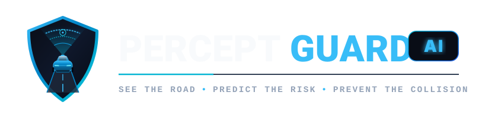

<div align="center">
  

  <h1>PerceptGuard-AI</h1>

  <p>
    <strong>See the Road. Predict the Risk. Prevent the Collision.</strong>
  </p>

  <p>
    <em>An independent, visibility-aware predictive road safety computer vision research prototype.</em>
  </p>

  <p>
    <a href="https://www.python.org/"></a>
    <a href="https://pytorch.org/"></a>
    <a href="https://github.com/ultralytics/ultralytics"></a>
    <a href="https://github.com/ifzhang/ByteTrack"></a>
    <a href="https://fastapi.tiangolo.com/"></a>
    <a href="https://react.dev/"></a>
    <a href="LICENSE"></a>
  </p>
</div>

---

## 1. Project Overview

**PerceptGuard-AI** is an advanced automotive computer vision and deep learning prototype designed to analyze road videos, detect road users, track their spatial movement over time, predict their potential future trajectories, assess collision risks, and generate evidence-driven driver safety advisories.

### Research Prototype Scope & Ethics
- **Scope**: Designed specifically for uploaded road video analysis.
- **Independence**: This is an independent research prototype developed for academic and engineering investigation. It is not Tesla technology, is not affiliated with Tesla or any automotive manufacturer, does not control vehicle steering or brakes, and is not safety-certified for live autonomous vehicle control.
- **Advisory Gate**: All recommendations are non-actuating safety advisories. Operational safety remains the human driver's sole responsibility.

---

## 2. Exactly Five Primary Analysis Modules

The application architecture organizes autonomous driving perception reliability into **exactly five connected primary modules**:

```
+─────────────────────────────────────────────────────────────────────────────────────────+
│                                  VIDEO INPUT WORKSPACE                                  │
│                    Standardized Ingestion • 720p / 30 FPS • CPU Optimized               │
+─────────────────────────────────────────────────────────────────────────────────────────+
                                             │
      ┌──────────────────┬───────────────────┼───────────────────┬──────────────────┐
      ▼                  ▼                   ▼                   ▼                  ▼
┌───────────────┐ ┌───────────────┐ ┌───────────────┐ ┌───────────────┐ ┌───────────────┐
│   MODULE 1    │ │   MODULE 2    │ │   MODULE 3    │ │   MODULE 4    │ │   MODULE 5    │
│    Camera &   │ │     Object    │ │   Trajectory  │ │   Collision   │ │     Safety    │
│    Weather    │ │   Detection   │ │   Prediction  │ │      Risk     │ │     Alerts    │
│               │ │  & ByteTrack  │ │               │ │   Assessment  │ │   Advisories  │
└───────────────┘ └───────────────┘ └───────────────┘ └───────────────┘ └───────────────┘
```

1. **Camera & Weather Intelligence (`src/camera_weather/`)**
   - Optical degradation analysis: Laplacian blur variance, Dark Channel Prior haze/fog estimation, directional Sobel precipitation patterns, and illumination/glare detection.
   - Temporal rolling tracking, degradation trend forecasting, and perception impact scoring ($P_{\text{impact}}$).

2. **Object Detection & ByteTrack Tracking (`src/detection/` & `src/tracking/`)**
   - High-throughput edge perception with Ultralytics YOLO11n ($45.5\text{ ms/frame}$ pure CPU).
   - Multi-class recognition: cars, motorcycles, bicycles, buses, trucks, and pedestrians.
   - ByteTrack Kalman filter state association preserving persistent track IDs across occlusions.

3. **Trajectory Prediction (`src/trajectory_prediction/`)**
   - Pinhole camera metric ground-plane projection converting image pixels to road meters.
   - 6-DoF Kalman filter trajectory forecasting across $H_1$ ($1\text{s}$), $H_3$ ($3\text{s}$), and $H_5$ ($5\text{s}$) horizons with acceleration damping ($0.88^k$).
   - Multi-agent interaction modeling: closing speed, time-to-headway ($TTH$), and crossing trajectory detection.

4. **Collision Risk Assessment (`src/collision_risk/`)**
   - First-order linear and second-order accelerated Time-To-Collision ($TTC$) calculation.
   - Travel corridor angle gating ($> 65^\circ$ lateral crossings marked invalid for longitudinal TTC).
   - Synchronous spatio-temporal conflict analysis across horizons $H_1, H_3, H_5$ eliminating false crossing alarms.
   - Multi-source uncertainty fusion ($U_{\text{weather}}, U_{\text{det}}, U_{\text{track}}$) triggering `UNKNOWN` when $U > 0.70$ or visibility $< 20\%$.

5. **Evidence-Driven Safety Alerts (`src/safety_recommendation/`)**
   - Final decision-support layer consuming outputs from Modules 1–4.
   - 6 explainable recommendation states: `NORMAL`, `CAUTION`, `REDUCE SPEED`, `PREPARE TO STOP`, `STOP RECOMMENDED`, and `UNKNOWN`.
   - 4 warning priority tiers: `INFO`, `ADVISORY`, `WARNING`, and `CRITICAL`.
   - Temporal early warning monitoring: risk escalation detection, rapidly decreasing TTC alerts, and pedestrian corridor intrusion.
   - Warning priority arbitration, duplicate alert suppression window ($0.35\text{s}$), and 2-frame de-escalation hysteresis.

---

## 3. Technology Stack

| Layer | Technologies |
| :--- | :--- |
| **Language & Runtime** | Python 3.10+ / 3.11 / 3.12 / 3.13 (Tested on Python 3.13.3) |
| **Computer Vision** | OpenCV (`opencv-python`), Ultralytics YOLO11 (`ultralytics`) |
| **Multi-Object Tracking** | ByteTrack (Kalman Filter + Two-Stage Association) |
| **Deep Learning** | PyTorch (Pure CPU-optimized execution, zero CUDA required) |
| **Backend API** | FastAPI, Uvicorn, Starlette, Pydantic v2 |
| **Frontend UI** | React 19 + TypeScript + Vite + Tailwind CSS + Lucide Icons + Recharts |
| **Hardware Target** | Intel Core i3 / i5 / i7, 8 GB RAM, Windows 11 AMD64 (Pure CPU) |
| **Testing** | Pytest, FastAPI TestClient, Vitest / Oxlint |

---

## 4. Local Development in VS Code (Windows 11)

PerceptGuard-AI runs locally out-of-the-box on Windows 11 with zero external cloud dependencies or paid APIs.

### Step 1: Clone the Repository
```powershell
git clone https://github.com/Jeeva1117/PerceptGuard-AI.git
cd PerceptGuard-AI
```

### Step 2: Configure Python Virtual Environment
```powershell
python -m venv venv
.\venv\Scripts\Activate.ps1
pip install --upgrade pip
pip install -r requirements.txt
```

### Step 3: Verify Environment and Model Weights
```powershell
python main.py --info
```
Ensure the two required model files are present:
- `models/yolo/yolo11n.pt` ($5.35\text{ MB}$)
- `models/forecasting/lstm/model.pt` ($101.1\text{ KB}$)

### Step 4: Install Frontend Dependencies
```powershell
cd frontend
npm install
cd ..
```

### Step 5: Start Backend and Frontend

**Terminal 1 — FastAPI Backend (Port 8000):**
```powershell
.\venv\Scripts\Activate.ps1
uvicorn src.api.app:app --host 127.0.0.1 --port 8000 --reload
```
- API Docs: [http://127.0.0.1:8000/docs](http://127.0.0.1:8000/docs)
- Health Probe: [http://127.0.0.1:8000/health/live](http://127.0.0.1:8000/health/live)

**Terminal 2 — Vite React UI (Port 3000):**
```powershell
cd frontend
npm run dev -- --host 127.0.0.1 --port 3000
```
- Web Application: [http://127.0.0.1:3000](http://127.0.0.1:3000)

---

## 5. End-to-End Workflow

1. Open [http://127.0.0.1:3000](http://127.0.0.1:3000) in your browser.
2. Click **Upload Video** and select an MP4 road video (or use reference videos from `outputs/day14_validation/clips/`).
3. Set your preferred frame count or analysis mode (**Full Balanced**, **Full Detailed**, or **Quick Preview**).
4. Click **Start Processing**. The pipeline will:
   - Extract and validate frames with OpenCV.
   - Run YOLO11n object detection.
   - Associate tracks with ByteTrack.
   - Forecast metric trajectories.
   - Calculate Time-to-Collision ($TTC$) and spatial conflict.
   - Generate safety recommendations.
5. Scrub through the continuous video playback workspace while inspecting live metrics across all five connected modules.

---

## 6. Project Structure

```
PerceptGuard-AI/
├── config/                  # YAML configurations (YOLO, ByteTrack, Video, Forecasting)
├── docker/                  # Dockerfile.backend and entrypoint.sh
├── docs/                    # Architectural and module documentation
├── frontend/                # React 19 / Vite SPA
│   ├── public/
│   │   ├── brand/           # Authentic PerceptGuard SVG logos and icons
│   │   └── favicon.svg      # Crisp browser favicon
│   └── src/                 # Components, context, pages, and services
├── models/                  # YOLO11n and LSTM PyTorch model checkpoints
├── outputs/                 # Persistent storage (jobs, uploads, validation clips)
├── src/                     # Core backend python package
│   ├── api/                 # FastAPI routers, job manager, and middleware
│   ├── camera_weather/      # Module 1: Optical degradation & visibility
│   ├── detection/           # Module 2A: Object detection
│   ├── tracking/            # Module 2B: ByteTrack multi-object tracking
│   ├── trajectory_prediction/# Module 3: Ground-plane trajectory forecasting
│   ├── collision_risk/      # Module 4: Spatial conflict & TTC analysis
│   └── safety_recommendation/# Module 5: Driver advisories & arbitration
├── tests/                   # Subsystem test suites
├── Dockerfile               # Production multi-stage Docker build
├── render.yaml              # Render Blueprint deployment definition
└── requirements.txt         # Core Python dependencies
```

---

## 7. License

This project is licensed under the MIT License — see the [LICENSE](LICENSE) file for details.
