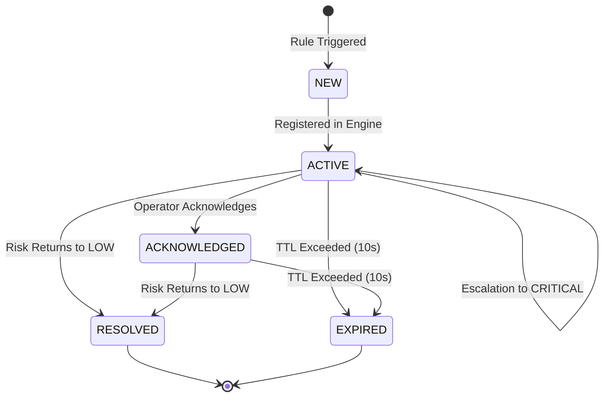

# Early Warning Alert Lifecycle Management

## 1. Lifecycle State Machine

Early warning alerts transition through five deterministic lifecycle states:

---

## 2. Transition Triggers & Invariants

| Transition | Trigger Condition | System Action | Audit Record |
| :--- | :--- | :--- | :--- |
| **`NEW -> ACTIVE`** | Rule criteria met; outside cooldown. | Alert registered in `active_alerts`; logged to `alert_history`. | `AlertLifecycleEvent(NEW -> ACTIVE)` |
| **`ACTIVE -> ACKNOWLEDGED`** | `acknowledge_alert(alert_id, operator)` invoked. | `acknowledgement_status = "ACKNOWLEDGED"`. | `AlertLifecycleEvent(ACTIVE -> ACKNOWLEDGED)` |
| **`ACTIVE -> RESOLVED`** | Reliability recovers to nominal `LOW` ($S_t \le 0.30$). | Alert removed from `active_alerts`; status updated. | `AlertLifecycleEvent(ACTIVE -> RESOLVED)` |
| **`ACTIVE -> EXPIRED`** | Time elapsed exceeds `alert_ttl_seconds` (default: 10s). | Alert removed from `active_alerts`; status updated. | `AlertLifecycleEvent(ACTIVE -> EXPIRED)` |
| **`ACTIVE -> ACTIVE` (Escalation)** | Higher severity condition occurs during cooldown. | Severity updated to `CRITICAL`; cooldown reset. | `AlertLifecycleEvent(ACTIVE -> ACTIVE, reason="Escalated")` |

---

## 3. Strict Safety Invariants

1. **No False Resolution on Missing Data:**
   When input telemetry disappears or is classified as `RiskLevel.UNKNOWN`, active alerts **must remain ACTIVE**. The system under no circumstances resolves an active alert merely because sensor data dropped out.
2. **Deterministic Audit Trail:**
   Every lifecycle transition generates an immutable `AlertLifecycleEvent` carrying alert ID, sequence ID, previous state, new state, timestamp, actor, and explanatory reason.
3. **Provisional Traceability:**
   Alerts and lifecycle events preserve `calibration_status = "PROVISIONAL"` until multi-video BDD100K calibration is achieved.
