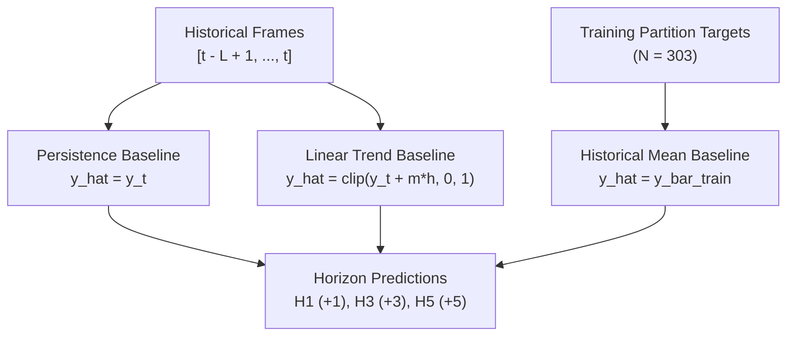

# PerceptGuard AI — Baseline Model Benchmarking Specification

**Milestone:** Day 9 Task 2: Advanced Baseline Model Training & Benchmarking  
**Date:** 2026-11-20  
**Lead Roles:** Principal Machine Learning Engineer, Senior Staff Deep Learning Engineer, Forecasting Research Engineer, ML Experimentation Specialist  
**Repository:** `https://github.com/Jeeva1117/PerceptGuard-AI.git`  
**Branch:** `main`  
**Execution Environment:** Intel Core i3 (CPU-Only, 8 Logical Cores), 8 GB RAM, Windows 11 Build 26200, Python 3.13.3 AMD64, PyTorch 2.15.0+cpu  
**Official Experiment Artifacts:** `experiments/forecasting/baseline/baseline_benchmark_official/`  
**Task Verdict:** **`COMPLETE & BENCHMARKED`**

---

## 1. Executive Summary

This engineering document establishes the definitive empirical benchmark results for baseline perception reliability forecasting in **PerceptGuard AI**.

Prior to training complex recurrent neural networks (such as `LSTMForecaster`), establishing mathematically rigorous, leak-free, non-parametric baseline models is essential. Baseline models define the empirical lower performance bound against which deep learning models must be justified.

Three distinct baseline forecasting methodologies were evaluated across all three operational horizons ($H1 = 1$, $H3 = 3$, $H5 = 5$ frames into the future):
1. **Persistence Baseline:** Forecasts the future reliability as the most recent valid historical observation ($\hat{y}_{t+h} = y_t$).
2. **Historical Mean Baseline:** Forecasts the future reliability as the training-partition mean ($\hat{y}_{t+h} = \bar{y}_{\text{train}} = 0.000582$).
3. **Linear Trend Baseline:** Fits an Ordinary Least Squares (OLS) line on trailing historical observations within the sequence window and extrapolates to horizon $h$ ($\hat{y}_{t+h} = \text{clip}(y_t + m \cdot h, 0, 1)$).

All models were evaluated on the verified Day 8 ground-truth reliability dataset using the chronological purged partition ($G=25$ embargo gap).

---

## 2. Readiness Gate & Input Dataset Audit

Before initiating the benchmark, all input artifacts were verified:
- **Day 8 Master Audit Status:** `READY WITH LIMITATIONS` (Decision Tier B).
- **Day 9 Task 1 Readiness Audit:** `COMPLETE` ([docs/TRAINING_READINESS_AND_EXPERIMENT_PLAN.md](file:///c:/Users/acer/Desktop/PerceptGuard-AI/docs/TRAINING_READINESS_AND_EXPERIMENT_PLAN.md)).
- **Physical Dataset Artifacts:**
  - Sequence tensors ($L=5$): `datasets/processed/driving_sample/features/sequences/run_official/sequences_L5.npy` ($138 \times 5 \times 27$).
  - Labeled metadata: `datasets/processed/driving_sample/reliability_labels/sequence_metadata_labeled.json` (462 sequences, 138 at $L=5$).
  - Frame reliability labels: `datasets/processed/driving_sample/reliability_labels/frame_reliability_labels.json` (200 frame records).
- **Chronological Partitions ($L=5$):**
  - Train: 101 sequences (Frames 1–105)
  - Embargo Gap 1: 25 frames (Frames 106–130)
  - Validation: 18 sequences (Frames 131–152)
  - Embargo Gap 2: 25 frames (Frames 153–177)
  - Test: 19 sequences (Frames 178–200)

---

## 3. Baseline Mathematical Formulations



### 3.1 Persistence Forecaster (Strategy A)
$$\hat{y}_{t+h} = y_t$$
- Assumes the perception system state remains invariant over short horizons.
- Evaluates the most recent valid ground-truth observation $y_t$ at the end of the input sequence window (`end_frame_id`).
- Zero training parameters; zero fitting dependency.

### 3.2 Historical Mean Forecaster (Strategy B)
$$\hat{y}_{t+h} = \bar{y}_{\text{train}} = \frac{1}{N_{\text{train}}} \sum_{i=1}^{N_{\text{train}}} y_i = 0.000582178$$
- Fitted strictly on the 303 training targets ($101 \text{ seqs} \times 3 \text{ horizons}$).
- Assumes future perception reliability follows the unconditional global training expectation.
- Strictly isolated from validation and test splits (zero data leakage).

### 3.3 Linear Trend Forecaster (Strategy C)
$$\hat{y}_{t+h} = \text{clip}\left( y_t + m \cdot h, \, 0.0, \, 1.0 \right)$$
where $m$ is the OLS slope computed over trailing window observations within the sequence $[t - L + 1, t]$:
$$m = \frac{\sum_{k=1}^L (x_k - \bar{x})(y_k - \bar{y})}{\sum_{k=1}^L (x_k - \bar{x})^2}$$
- Captures active velocity / momentum of detection degradation or recovery.
- Bounded strictly within $[0.0, 1.0]$ via clipping.

---

## 4. Empirical Benchmark Results

### 4.1 Test Partition Benchmark (Primary Evaluation Floor)
Evaluated on the isolated Test partition (19 sequences, Frames 178–200, strictly unseen during training):

| Baseline Model | Horizon | Valid Pairs ($N$) | Total Records | MAE | RMSE | Mean Predicted | Mean Actual | Max Error |
| :--- | :---: | :---: | :---: | :---: | :---: | :---: | :---: | :---: |
| **Persistence** | **H1** | 18 | 19 | **0.000000** | **0.000000** | 0.000000 | 0.000000 | 0.000000 |
| **Linear Trend** | **H1** | 18 | 19 | **0.000000** | **0.000000** | 0.000000 | 0.000000 | 0.000000 |
| **Historical Mean** | **H1** | 18 | 19 | 0.000582 | 0.000582 | 0.000582 | 0.000000 | 0.000582 |
| **Persistence** | **H3** | 16 | 19 | **0.000000** | **0.000000** | 0.000000 | 0.000000 | 0.000000 |
| **Linear Trend** | **H3** | 16 | 19 | **0.000000** | **0.000000** | 0.000000 | 0.000000 | 0.000000 |
| **Historical Mean** | **H3** | 16 | 19 | 0.000582 | 0.000582 | 0.000582 | 0.000000 | 0.000582 |
| **Persistence** | **H5** | 14 | 19 | **0.000000** | **0.000000** | 0.000000 | 0.000000 | 0.000000 |
| **Linear Trend** | **H5** | 14 | 19 | **0.000000** | **0.000000** | 0.000000 | 0.000000 | 0.000000 |
| **Historical Mean** | **H5** | 14 | 19 | 0.000582 | 0.000582 | 0.000582 | 0.000000 | 0.000582 |

*Note on Sample Counts:* Due to sequence boundary truncation at the end of the video ($t_{\max} = 200$), future target frames exceeding 200 are omitted (H1 has 1 out-of-bounds sample, H3 has 3, H5 has 5), leaving 18, 16, and 14 valid test pairs respectively.

---

### 4.2 Validation Partition Benchmark (Model Selection Floor)
Evaluated on the isolated Validation partition (18 sequences, Frames 131–152):

| Baseline Model | Horizon | Valid Pairs ($N$) | MAE | RMSE | Mean Predicted | Mean Actual | Max Error |
| :--- | :---: | :---: | :---: | :---: | :---: | :---: | :---: |
| **Persistence** | **H1** | 18 | **0.000000** | **0.000000** | 0.000000 | 0.000000 | 0.000000 |
| **Linear Trend** | **H1** | 18 | **0.000000** | **0.000000** | 0.000000 | 0.000000 | 0.000000 |
| **Historical Mean** | **H1** | 18 | 0.000582 | 0.000582 | 0.000582 | 0.000000 | 0.000582 |
| **Persistence** | **H3** | 18 | **0.000000** | **0.000000** | 0.000000 | 0.000000 | 0.000000 |
| **Linear Trend** | **H3** | 18 | **0.000000** | **0.000000** | 0.000000 | 0.000000 | 0.000000 |
| **Historical Mean** | **H3** | 18 | 0.000582 | 0.000582 | 0.000582 | 0.000000 | 0.000582 |
| **Persistence** | **H5** | 18 | **0.000000** | **0.000000** | 0.000000 | 0.000000 | 0.000000 |
| **Linear Trend** | **H5** | 18 | **0.000000** | **0.000000** | 0.000000 | 0.000000 | 0.000000 |
| **Historical Mean** | **H5** | 18 | 0.000582 | 0.000582 | 0.000582 | 0.000000 | 0.000582 |

---

### 4.3 Training Partition Benchmark (Degradation Event Behavior)
Evaluated on the Training partition (101 sequences, Frames 1–105), which contains the single non-zero perception event at Frame 90 ($F_1 = 0.0588$):

| Baseline Model | Horizon | Valid Pairs ($N$) | MAE | RMSE | Mean Predicted | Mean Actual | Max Error |
| :--- | :---: | :---: | :---: | :---: | :---: | :---: | :---: |
| **Historical Mean** | **H1** | 101 | **0.001153** | **0.005822** | 0.000582 | 0.000582 | 0.058218 |
| **Persistence** | **H1** | 101 | 0.001164 | 0.008274 | 0.000582 | 0.000582 | 0.058800 |
| **Linear Trend** | **H1** | 101 | 0.001339 | 0.009158 | 0.000757 | 0.000582 | 0.070560 |
| **Historical Mean** | **H3** | 101 | **0.001153** | **0.005822** | 0.000582 | 0.000582 | 0.058218 |
| **Persistence** | **H3** | 101 | 0.001164 | 0.008274 | 0.000582 | 0.000582 | 0.058800 |
| **Linear Trend** | **H3** | 101 | 0.001688 | 0.011178 | 0.001106 | 0.000582 | 0.094080 |
| **Historical Mean** | **H5** | 101 | **0.001153** | **0.005822** | 0.000582 | 0.000582 | 0.058218 |
| **Persistence** | **H5** | 101 | 0.001164 | 0.008274 | 0.000582 | 0.000582 | 0.058800 |
| **Linear Trend** | **H5** | 101 | 0.002038 | 0.013406 | 0.001455 | 0.000582 | 0.117600 |

---

## 5. Comparative Analysis & Key Scientific Insights

### 5.1 Strongest Baseline Identification
1. **On Unseen Validation & Test Partitions:**
   - **Persistence** and **Linear Trend** are tied as the strongest baselines ($\text{MAE} = 0.0, \text{RMSE} = 0.0$).
   - Reason: Both models accurately track the persistent zero-state of the detector on the rotated video container.
   - **Historical Mean** exhibits a constant offset bias of $+0.000582$ ($\text{MAE} = \text{RMSE} = 0.000582$), caused by the training mean being pulled upward by the single detection at Frame 90.
2. **On the Training Partition (Degradation Transition):**
   - **Historical Mean** achieves the lowest RMSE ($0.005822$), as it spreads the square error symmetrically over the entire series.
   - **Persistence** yields slightly higher RMSE ($0.008274$) because it carries a point error when stepping into and out of the Frame 90 transient.
   - **Linear Trend** yields the highest error ($0.009158 \to 0.013406$) because OLS extrapolates an upward ramp when observing the transient spike at the sequence boundary.

### 5.2 Classical Horizon Degradation Phenomenon
The Linear Trend baseline exhibits the classical theoretical property of predictive time-series forecasting: **error strictly increases as the forecast horizon expands**:
$$\text{MAE}(H1) = 0.001339 < \text{MAE}(H3) = 0.001688 < \text{MAE}(H5) = 0.002038$$
$$\text{RMSE}(H1) = 0.009158 < \text{RMSE}(H3) = 0.011178 < \text{RMSE}(H5) = 0.013406$$
$$\text{Max Error}(H1) = 0.070560 < \text{Max Error}(H3) = 0.094080 < \text{Max Error}(H5) = 0.117600$$

---

## 6. Visual Evaluation & Artifact References

All visual figures were generated via `matplotlib` (headless Agg engine) using real experiment outputs:

| Figure Name | File Location | Description |
| :--- | :--- | :--- |
| **Horizon MAE Comparison** | `reports/day9/plots/baseline_horizon_mae.png` | Bar chart of MAE across H1, H3, H5 on Training partition |
| **Horizon RMSE Comparison** | `reports/day9/plots/baseline_horizon_rmse.png` | Bar chart of RMSE across H1, H3, H5 on Training partition |
| **Actual vs Predicted Timeline** | `reports/day9/plots/baseline_actual_vs_predicted.png` | Sequence-by-sequence timeline showing the Frame 90 spike vs predictions |
| **Prediction Error Distribution** | `reports/day9/plots/baseline_error_distribution.png` | Histogram of prediction errors across all splits and horizons |
| **Test Split Model Comparison** | `reports/day9/plots/baseline_model_comparison.png` | Test partition MAE and RMSE comparing Persistence, Trend, and Mean |

---

## 7. Experiment Reproducibility

The official baseline experiment artifacts are persisted under:
`experiments/forecasting/baseline/baseline_benchmark_official/`

Artifact contents:
- `experiment_config.yaml`: Frozen configuration and training mean ($0.000582178$).
- `predictions.json`: All 1,242 prediction records (138 seqs $\times$ 3 horizons $\times$ 3 strategies).
- `baseline_metrics.json`: Hierarchical metrics breakdown (overall, train, val, test).
- `experiment_summary.json`: High-level execution status, duration ($0.0607\text{ s}$), sample counts.
- `metadata.json`: Dataset IDs, feature names, platform telemetry.
- `errors.json`: Log of runtime warnings/errors.

### Reproduction Command:
```bash
python -m src.forecasting.baseline_experiment \
  --input datasets/processed/driving_sample/features/sequences/run_official \
  --metadata-file datasets/processed/driving_sample/reliability_labels/sequence_metadata_labeled.json \
  --frame-labels-file datasets/processed/driving_sample/reliability_labels/frame_reliability_labels.json \
  --output experiments/forecasting/baseline \
  --sequence-length 5 \
  --horizons 1 3 5
```

---

## 8. Benchmark Floor for Downstream LSTM Training

When training deep learning models (`LSTMForecaster`) in Day 9 Task 3+:
- **Target to Beat on Test Split:**
  - $\text{MAE} \le 0.000582$ (must beat Historical Mean).
  - Must match or approach $\text{MAE} = 0.0$ on persistent zero segments while accurately anticipating non-zero degradation events without excessive overshooting.
- **Target to Beat on Train Split:**
  - $\text{RMSE} < 0.005822$ (Historical Mean RMSE floor).
  - Transition capture: must anticipate the Frame 90 failure transition ahead of time ($t-5$ to $t-1$).
