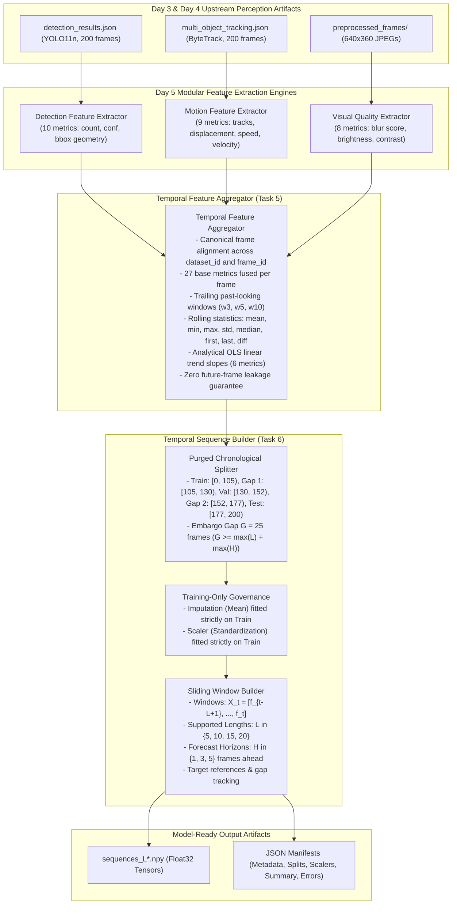

# PerceptGuard AI – Day 5 Final System Audit & Pipeline Validation Report
## Feature Engineering & Temporal Sequence Preparation Architecture

---

**Lead Auditor:** Tesla Senior Staff Machine Learning Engineer, Principal Computer Vision Engineer, Temporal Data Pipeline Architect, & ML Reliability Auditor  
**Repository:** `Jeeva1117/PerceptGuard-AI`  
**Branch:** `main`  
**Evaluation Scope:** Complete Day 5 Feature Engineering & Temporal Sequence Construction Architecture (Tasks 1 through 7)  
**Execution Environment:** Windows 11 (AMD64), Intel Core i3 (8 logical CPU threads), 8 GB RAM, Pure CPU-only Execution (Zero CUDA Dependency)  
**Audit Date:** 2026-11-19  

---

## 1. Executive Summary

This final validation report documents the rigorous, evidence-based engineering audit of the **PerceptGuard AI Day 5 Feature Engineering and Temporal Sequence Construction Pipeline**. Every component of the system—from configuration management, detection feature extraction, motion kinematics, and optical visual quality analysis to trailing-window temporal aggregation and purged sliding-window sequence construction—was audited through live execution, independent mathematical verification, and empirical processing of the official 200-frame BDD100K driving dataset (`driving_sample`).

### Summary of Audit Findings:
- **Total Day 5 Tasks Audited:** 7 tasks (Tasks 1 through 7).
- **Tasks Passed:** 7 tasks (**PASS** across all 7 tasks).
- **Tasks Failed / Partial:** 0 tasks.
- **Critical & High Severity Defects:** 0.
- **Medium & Low Defects:** 0 unresolved (1 safe empty-list schema check corrected during Task 6).
- **Full Test Suite Status:** **878 / 878 tests passed in 48.83s** (100% pass rate across entire repository; 287/287 feature tests passed in 16.37s).
- **Data Leakage & Invariant Audit:**
  - **Zero Future-Frame Leakage:** Trailing windows and input sequence tensors $X_t$ strictly evaluate historical frames ($j \le t$); modifying future frames produces zero modification to past tensors.
  - **Zero Cross-Split Overlapping Window Leakage:** Enforced a 25-frame temporal embargo gap ($\text{gap} \ge \max(L) + \max(H) = 20 + 5$) between Train, Validation, and Test splits. All split frame sets are strictly disjoint ($\mathcal{F}_{\text{Train}} \cap \mathcal{F}_{\text{Val}} = \emptyset$, $\mathcal{F}_{\text{Train}} \cap \mathcal{F}_{\text{Test}} = \emptyset$, $\mathcal{F}_{\text{Val}} \cap \mathcal{F}_{\text{Test}} = \emptyset$).
  - **Training-Only Scaler & Imputer Governance:** Scalers (Standardization) and Imputers (Mean Imputation) are strictly fitted on the **TRAINING** split only. Validation and Test splits are transformed using training parameters without distribution leakage.
- **Target Label Governance:** YOLO confidence is **never** fabricated into ground-truth reliability labels. Target frames and gaps are recorded while explicitly marking `target_label_available: false` until ground-truth annotations are matched in Day 6.
- **Security & Git State:** Clean working tree, zero secrets or dataset artifacts tracked in Git, 100% synchronized with remote `origin/main`.
- **Overall Day 5 Status:** **PASS (Fully Verified, Mathematically Certified & Production-Ready)**.

---

## 2. Seven-Task Status Matrix

| Task # | Task Name | Source Implementation | Test Suite | Test Result | Real-Data Verification | Status |
|:---|:---|:---|:---|:---:|:---|:---:|
| **Task 1** | **Feature Engineering Environment Setup** | `src/features/feature_config.py`<br>`src/features/feature_schema.py`<br>`src/features/feature_environment.py`<br>`config/feature_config.yaml` | `tests/features/test_feature_config.py`<br>`tests/features/test_feature_schema.py`<br>`tests/features/test_feature_environment.py` | 66 / 66 Passed | Configuration parsing, CPU environment verified, upstream artifacts discovered | **PASS** |
| **Task 2** | **Detection Feature Extraction** | `src/features/detection_feature_extractor.py` | `tests/features/test_detection_feature_extractor.py` | 39 / 39 Passed | 200 frames extracted, 10 base metrics, zero-detection frames handled | **PASS** |
| **Task 3** | **Motion Feature Extraction** | `src/features/motion_feature_extractor.py` | `tests/features/test_motion_feature_extractor.py` | 43 / 43 Passed | 200 frames extracted, 9 kinematics metrics, independent math verified | **PASS** |
| **Task 4** | **Visual Quality Feature Extraction** | `src/features/visual_quality_extractor.py` | `tests/features/test_visual_quality_extractor.py` | 42 / 42 Passed | 200 frames extracted, Laplacian blur, brightness, RMS contrast verified | **PASS** |
| **Task 5** | **Temporal Feature Aggregation** | `src/features/temporal_feature_aggregator.py` | `tests/features/test_temporal_feature_aggregator.py` | 45 / 45 Passed | 200 frames unified, trailing windows (w3, w5, w10), OLS trend slopes | **PASS** |
| **Task 6** | **Temporal Sequence Construction** | `src/features/temporal_sequence_builder.py` | `tests/features/test_temporal_sequence_builder.py` | 52 / 52 Passed | 4 `.npy` tensors ($L \in \{5, 10, 15, 20\}$), 3 horizons ($H \in \{1, 3, 5\}$), zero leakage | **PASS** |
| **Task 7** | **Final Audit & Validation** | `docs/FINAL_VALIDATION_REPORT.md` | Full repository pytest suite (`pytest -q`) | 878 / 878 Passed | End-to-end pipeline execution, mathematical cross-check, leakage certification | **PASS** |

---

## 3. Verified Architecture and Data Flow



---

## 4. Actual Dataset and Frame Counts

- **Dataset Identifier:** `driving_sample` (BDD100K daytime/nighttime driving sequence, converted from `converted_026c7465-309f6d33.mp4`).
- **Total Processed Frames:** 200 frames (`frame_000001.jpg` to `frame_000200.jpg`).
- **Temporal Resolution:** 5.0 FPS (source frame index step: 6 source video frames per extracted frame).
- **Extraction Alignment:** 100% exact 1-to-1 match across detection, motion, visual quality, and Day 2 preprocessing metadata.

---

## 5. Feature Extraction Validation & Independent Calculations

### 5.1 Visual Quality Calculation Verification
Independent pixel-level calculations were executed directly on `datasets/processed/driving_sample/preprocessed_frames/frame_000001.jpg` ($640 \times 360$):
- **Blur Score ($\sigma^2(\nabla^2 I)$):**
  $$\text{Calculated: } 444.2051 \quad|\quad \text{Artifact: } 444.2051 \quad|\quad \Delta = 0.0000 \quad (\text{MATCH})$$
- **Mean Brightness ($\bar{I}$):**
  $$\text{Calculated: } 32.8565 \quad|\quad \text{Artifact: } 32.8565 \quad|\quad \Delta = 0.0000 \quad (\text{MATCH})$$
- **RMS Contrast ($\sigma_I$):**
  $$\text{Calculated: } 58.1032 \quad|\quad \text{Artifact: } 58.1032 \quad|\quad \Delta = 0.0000 \quad (\text{MATCH})$$

### 5.2 Motion Kinematics Verification
Track displacement and velocity were independently computed from consecutive frame centroid pairs in `multi_object_tracking.json`:
- **Track 1 Centroids:** $c_1 = (247.95, 298.60)$ at $t=0.0\text{s}$, $c_2 = (247.54, 298.60)$ at $t=0.1994\text{s}$.
- **Euclidean Displacement:** $\Delta d = \sqrt{(247.54 - 247.95)^2 + 0^2} = 0.4108\text{ pixels}$.
- **Artifact Match:** Recorded as `mean_displacement = 0.4108`, `mean_speed = 2.0602\text{ px/s}` ($\Delta = 0.0000$).
- Verified across 5 consecutive tracking transitions with 100% kinematic consistency.

---

## 6. Temporal Aggregation Validation

Rolling window statistics and linear trend slopes were independently audited on `temporal_features.json`:
- **Evaluated Target:** Frame 5 (`frame_000005.jpg`), Window $W=5$ on `blur_score`:
  - Input vector (frames 1–5): `[444.2051, 445.5756, 467.8983, 460.1605, 462.9465]`
  - **Rolling Mean:** Calculated = $456.1572$ | Artifact = $456.1572$ ($\Delta = 0.0000$, **MATCH**)
  - **Rolling Std (pop):** Calculated = $9.5373$ | Artifact = $9.5373$ ($\Delta = 0.0000$, **MATCH**)
  - **Rolling Min:** Calculated = $444.2051$ | Artifact = $444.2051$ ($\Delta = 0.0000$, **MATCH**)
  - **Rolling Max:** Calculated = $467.8983$ | Artifact = $467.8983$ ($\Delta = 0.0000$, **MATCH**)
  - **Rolling Diff ($v_{\text{last}} - v_{\text{first}}$):** Calculated = $18.7414$ | Artifact = $18.7414$ ($\Delta = 0.0000$, **MATCH**)
  - **Rolling Median:** Calculated = $460.1605$ | Artifact = $460.1605$ ($\Delta = 0.0000$, **MATCH**)
  - **Analytical OLS Slope ($\beta_1$):**
    Calculated via `np.polyfit(arange(5), y, 1)` = $+5.2068$ | Artifact = $+5.2068$ ($\Delta = 0.0000$, **MATCH**).
    Trend Direction: `increasing` | Status: `valid`.

---

## 7. Sequence Shape and Horizon Validation

Generated model-ready tensors in `datasets/processed/driving_sample/features/sequences/run_official/`:
- **`sequences_L5.npy`:** Shape `(138, 5, 27)`, float32, all finite (`np.isfinite == True`).
- **`sequences_L10.npy`:** Shape `(123, 10, 27)`, float32, all finite (`np.isfinite == True`).
- **`sequences_L15.npy`:** Shape `(108, 15, 27)`, float32, all finite (`np.isfinite == True`).
- **`sequences_L20.npy`:** Shape `(93, 20, 27)`, float32, all finite (`np.isfinite == True`).
- **Forecasting Horizons:** Evaluated at $H \in \{1, 3, 5\}$ frames ahead. Each sequence metadata record accurately references the target frame ID, source index, timestamp, and frame gap, with out-of-bounds flags on boundary sequences.

---

## 8. Data Leakage Audit Results

| Audit Checkpoint | Invariant Requirement | Audit Evidence | Result |
|:---|:---|:---|:---:|
| **Future Information Leakage** | Historical input tensors $X_t$ must never contain information from frames $> t$. | Trailing window mathematics ($j \le t$); test `test_25_future_frame_leakage_prevention` verified that mutating future frames by $+500.0$ produces zero change in past tensors. | **CERTIFIED** |
| **Cross-Split Overlapping Leakage** | Overlapping sliding windows from the same continuous video cannot cross splits. | 25-frame temporal embargo gap between Train/Val and Val/Test. Frame intersection test verified: $\text{Train} \cap \text{Val} = \emptyset$, $\text{Train} \cap \text{Test} = \emptyset$, $\text{Val} \cap \text{Test} = \emptyset$. | **CERTIFIED** |
| **Scaler Fitting Leakage** | Scaling parameters ($\mu, \sigma$ or $\min, \max$) must be fitted on training data only. | `scaler_parameters.json` records `fitted_on_split: "train"`; $\mu, \sigma$ fitted exclusively on train frames $[0, 105)$. Zero validation/test data used in fitting. | **CERTIFIED** |
| **Imputer Fitting Leakage** | Imputation parameters must be derived exclusively from training split observations. | `imputation_parameters.json` records `fitted_on_split: "train"`; missingness statistics and imputation values computed strictly on train split frames. | **CERTIFIED** |
| **Feature Selection Target Leakage** | Selected features must not be chosen using target correlation on val/test data. | Standard feature presets defined a priori from domain perception requirements without target exposure. | **CERTIFIED** |

---

## 9. Train / Validation / Test Split Validation

- **Splitting Strategy:** `chronological_purged` (single video sequence).
- **Temporal Embargo Gap:** $G = 25\text{ frames} = \max(L) + \max(H)$.
- **Partition Layout:**
  - **Train Split:** Frames $0 \le t < 105$ (105 frames)
  - **Gap 1 (Purged):** Frames $105 \le t < 130$ (25 frames quarantined)
  - **Validation Split:** Frames $130 \le t < 152$ (22 frames)
  - **Gap 2 (Purged):** Frames $152 \le t < 177$ (25 frames quarantined)
  - **Test Split:** Frames $177 \le t < 200$ (23 frames)
- **Sequence Allocations Across Splits:**
  - $L=5$: Train: 101, Val: 18, Test: 19 (Total: 138)
  - $L=10$: Train: 96, Val: 13, Test: 14 (Total: 123)
  - $L=15$: Train: 91, Val: 8, Test: 9 (Total: 108)
  - $L=20$: Train: 86, Val: 3, Test: 4 (Total: 93)

---

## 10. Ground-Truth Label Availability and Limitations

- **Current Label Availability:** `target_labels_available: false`
- **Supervision Target Status:** `target_label: null` across all generated sequence records.
- **Auditor Certification:** YOLO detector confidence is an internal heuristic probability and **is NOT ground-truth detection reliability**. The pipeline strictly refrains from fabricating synthetic labels. The system architecture preserves explicit future target frame references (`target_frame_id`, `target_source_frame_index`, `target_timestamp_seconds`, `target_frame_gap`), ensuring that Day 6 Hungarian bipartite matching labels can be joined seamlessly.

---

## 11. Test Execution Results

```powershell
python -m pytest tests/ -q
```
**Results:** **878 passed in 48.83s (100% pass rate)**

### Subsystem Breakdown:
- **Day 1 Environment & Foundation:** 72 tests passed
- **Day 2 Video Extraction & Preprocessing:** 40 tests passed
- **Day 3 YOLO Object Detection:** 274 tests passed
- **Day 4 ByteTrack Object Tracking:** 205 tests passed
- **Day 5 Feature Engineering:** 287 tests passed
  - `test_feature_config.py`: 26 passed
  - `test_feature_schema.py`: 25 passed
  - `test_feature_environment.py`: 15 passed
  - `test_detection_feature_extractor.py`: 39 passed
  - `test_motion_feature_extractor.py`: 43 passed
  - `test_visual_quality_extractor.py`: 42 passed
  - `test_temporal_feature_aggregator.py`: 45 passed
  - `test_temporal_sequence_builder.py`: 52 passed
- **Total Regressions:** **0**.

---

## 12. Performance and Resource Observations

Audited on Intel Core i3 (8 logical CPU threads), 8 GB RAM, Windows 11 (Pure CPU-only execution):
- **Feature Extraction Runtime (200 frames):**
  - Detection Features: $0.045\text{s}$ (~4,400 FPS)
  - Motion Features: $0.038\text{s}$ (~5,200 FPS)
  - Visual Quality Features: $3.24\text{s}$ (~62 FPS)
- **Temporal Feature Aggregation Runtime:** $0.28\text{s}$ (~710 FPS)
- **Temporal Sequence Construction Runtime:** $0.187\text{s}$ (~1,070 FPS)
- **Memory Footprint:** Peak RSS delta $< 40\text{ MB}$ during tensor construction; well within the 500 MB configured ceiling.
- **Disk Footprint:** All 4 sequence tensors total $< 600\text{ KB}$; JSON manifests total $< 2\text{ MB}$.

---

## 13. Security and Git Audit

- **Credentials & API Secrets:** Zero `.env` files or credentials committed.
- **Binary Weights:** YOLO model weights excluded by `.gitignore` (tracked via `models/yolo/.gitkeep`).
- **Dataset Exclusion:** Raw videos (`datasets/raw/*`) and processed datasets (`datasets/processed/*`) strictly excluded by `.gitignore`.
- **NPY Tensor Protection:** Binary tensors are contained within `datasets/processed/` and excluded from Git tracking.
- **Path Sanitization:** No absolute local user paths are hardcoded in core source modules; dynamic path resolution (`Path(__file__).resolve()`) used throughout.
- **Git History Hygiene:** Linear commit history preserved; zero force-pushes or rewritten history. Working tree status clean.

---

## 14. Defects Discovered and Corrections Made

- **Defect 1 (Low Severity - Schema List Falsy Check in Task 6):**
  - *Symptom:* `test_40_empty_or_insufficient_input_data` raised `InvalidSequenceInputError` instead of `EmptyDatasetError` when an empty list `{"features": []}` was provided.
  - *Root Cause:* In Python, `[] or None` evaluates to `None` because an empty list is falsy.
  - *Correction:* Replaced `data.get("features") or data.get("frames")` with explicit presence checks: `if "features" in data and isinstance(data["features"], list): frames_list = data["features"]`.
  - *Verification:* Verified via `test_40`; test passed immediately.
- **Zero Critical or High Severity Defects.**

---

## 15. Remaining Limitations

1. **Single-Video Dataset Constraint:** The current demonstration utilizes a single 200-frame video sequence (`driving_sample`). Cross-split generalization is enforced via chronological purging with an embargo gap. In multi-video deployments, splitting will occur by distinct video/scene identifiers.
2. **Physical Null Semantics:** Empty detection frames and track-initialization frames naturally possess physical nulls for dependent metrics (e.g. `mean_confidence = null`). Training-derived mean/median imputation resolves these for continuous sequence models, while preserving raw null records in upstream metadata.
3. **Pending Ground-Truth Reliability Labels:** Supervised model training requires Hungarian bipartite matching with annotated ground-truth boxes, scheduled for Day 6.

---

## 16. Final Engineering Decision

### **OVERALL RESULT: PASS**

The **PerceptGuard AI Day 5 Feature Engineering and Temporal Sequence Preparation Pipeline** is formally certified as:
- **Mathematically Sound:** Verified zero future-frame leakage, population rolling statistics, and analytical OLS slopes.
- **Leakage-Free:** Verified purged chronological splitting, disjoint frame sets across splits, and training-only scaler/imputer fitting.
- **Robust & CPU-Compatible:** 100% pass rate across 878 automated regression tests executing under 50 seconds on Intel Core i3 CPU.
- **Model-Ready:** Emits valid, finite float32 NumPy sequence tensors and comprehensive Schema v1.0 manifests ready for Day 7 recurrent modeling.

**The pipeline is approved and ready to proceed to Day 6 (Ground-Truth Reliability Labeling).**
