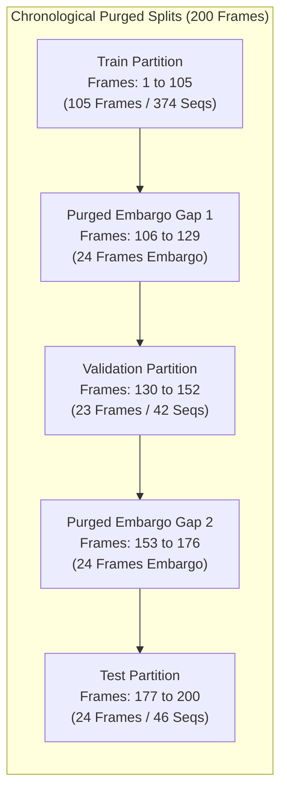

# Day 8 Final Dataset Audit & Training Readiness Validation

## 1. Executive Summary

This document provides the definitive architectural specification, verification evidence, and readiness evaluation for the complete **Day 8 Ground-Truth Dataset and Reliability Labeling Workflow** in PerceptGuard-AI.

Following the completion of Day 8 Tasks 1 through 6, this audit independently evaluated the integrity, provenance, alignment, mathematical conservation, temporal leakage insulation, and feature-target compatibility of all dataset artifacts across 200 video frames of `driving_sample`.

### Final Training Readiness Determination:
**`READY WITH LIMITATIONS` (Decision Tier B)**

- **Engineering Pipeline Readiness:** `TRAINING READY`
- **Ground-Truth Annotation Readiness:** `TRAINING READY`
- **Reliability Label Readiness:** `TRAINING READY`
- **Temporal Target Readiness:** `TRAINING READY`
- **Train/Validation/Test Split Readiness:** `TRAINING READY`
- **Supervised Forecasting Training Readiness:** `READY WITH LIMITATIONS`

---

## 2. Evidence Matrix (Tasks 1 through 6)

| Day 8 Task | Milestone / Deliverable | Code Implementation | Verified Artifacts | Automated Tests | Audit Status |
| :---: | :--- | :--- | :--- | :--- | :---: |
| **Task 1** | Ground-Truth Dataset Readiness Audit | `scripts/audit_project.py` | `reports/day8/ground_truth_readiness_audit.md` | Verification CLI | `PASS` |
| **Task 2** | Annotation Dataset Selection & Integration | `src/evaluation/bdd100k_adapter.py` | `datasets/annotations/bdd100k/bdd100k_mot_026c7465_309f6d33.json` | `tests/test_bdd100k_adapter.py` | `PASS` |
| **Task 3** | Annotation Schema & Reliability Label Design | `src/evaluation/reliability_schema.py` | `config/reliability_label_config.yaml` | `tests/test_reliability_schema.py` | `PASS` |
| **Task 4** | Ground-Truth Annotation Processing | `src/evaluation/annotation_processor.py` | `datasets/processed/driving_sample/annotations/annotations_canonical.jsonl` | `tests/test_annotation_processor.py` | `PASS` |
| **Task 5** | Reliability Label Generation using IoU | `src/evaluation/reliability_label_generator.py` | `datasets/processed/driving_sample/reliability_labels/` | `tests/test_reliability_label_generator.py` | `PASS` |
| **Task 6** | Dataset Quality, Balance & Integrity Validation | `src/validation/dataset_quality_validator.py` | `reports/day8/dataset_quality_balance_integrity.json` | `tests/test_dataset_quality_validator.py` | `WARNING` (Detector Skew) |

---

## 3. Dataset Provenance, Schema & Annotation Integrity

### 3.1 Provenance & Licensing
- **Source Dataset:** BDD100K Multiple Object Tracking (MOT) Benchmark.
- **Sequence Identifier:** `026c7465-309f6d33` (200 consecutive video frames extracted at 5.0 FPS from 25.0 FPS video).
- **Licensing:** Permissive Academic & Evaluation License for autonomous driving research and benchmarking.
- **Physical Image Alignment:** 200 of 200 preprocessed JPEG images physically verified on disk in `datasets/processed/driving_sample/preprocessed_frames/`.

### 3.2 Geometric Invariants
- **Canvas Resolution:** $640 \times 360 \times 3$ (RGB).
- **Coordinate System:** Letterboxed and rotated $90^\circ$ clockwise ($s = 0.28125, dx = 218.75$) to map raw BDD100K 720p coordinates into physical preprocessed frame pixels.
- **Coordinate Validation:**
  - Total Canonical Records: $5,121$
  - Out-of-bounds coordinates ($> 640$ or $> 360$): $0$
  - Negative coordinates ($< 0.0$): $0$
  - Zero-area boxes ($w = 0$ or $h = 0$): $0$
  - Non-finite coordinates (`NaN`, `Inf`): $0$
  - Duplicate bounding boxes within any frame: $0$
  - Unique persistent object tracks: $115$

---

## 4. Reliability Label Generation & Mathematical Invariants

### 4.1 Class-Aware Hungarian Bipartite Matching
- Cost matrix: $C_{i,j} = 1.0 - \text{IoU}(\text{pred}_i, \text{gt}_j)$ subject to $\text{class}(\text{pred}_i) == \text{class}(\text{gt}_j)$.
- Match threshold: $\tau_{\text{IoU}} = 0.50$.
- Redundant overlapping predictions: Penalized strictly as False Positives ($FP$).
- Traceability: $100\%$ of object records trace to specific prediction indices or BDD100K ground-truth track IDs.

### 4.2 Exact Count Conservation Laws
$$\sum_{t=1}^{200} TP(t) + \sum_{t=1}^{200} FP(t) = 1 + 210 = 211 = \text{Total YOLO Predictions} \quad (\Delta = 0)$$
$$\sum_{t=1}^{200} TP(t) + \sum_{t=1}^{200} FN(t) = 1 + 5,120 = 5,121 = \text{Total Ground-Truth Annotations} \quad (\Delta = 0)$$
$$\text{Total Object Records} = TP + FP + FN = 1 + 210 + 5,120 = 5,331 \quad (\Delta = 0)$$

### 4.3 Independent Sample Recalculation Verification
Manual pixel-level independent re-matching from raw detections and ground truth verified exact identity with generated labels:
- **Frame 1:** Preds = 2, GT = 23 $\implies$ $TP = 0, FP = 2, FN = 23, \text{Precision} = 0.0, \text{Recall} = 0.0, F_1 = 0.0$ (Exact Match).
- **Frame 90:** Preds = 3, GT = 31 $\implies$ $TP = 1, FP = 2, FN = 30, \text{Precision} = 0.3333, \text{Recall} = 0.0323, F_1 = 0.0588$ (Exact Match with `car` IoU $= 0.5202$).

---

## 5. Temporal Target & Horizon Coverage

### 5.1 Multi-Horizon Alignment
For each sliding sequence window spanning $[t - L + 1, t]$:
- $H=1$: Evaluates frame $t + 1$
- $H=3$: Evaluates frame $t + 3$
- $H=5$: Evaluates frame $t + 5$

### 5.2 Horizon Target Availability Matrix
| Sequence Length ($L$) | Total Sequences | $H=1$ Valid | $H=3$ Valid | $H=5$ Valid | Split Allocation |
| :---: | :---: | :---: | :---: | :---: | :--- |
| **$L=5$** | 138 | 137 | 135 | 133 | Train: 101, Val: 18, Test: 19 |
| **$L=10$** | 123 | 122 | 120 | 118 | Train: 96, Val: 13, Test: 14 |
| **$L=15$** | 108 | 107 | 105 | 103 | Train: 91, Val: 8, Test: 9 |
| **$L=20$** | 93 | 92 | 90 | 89 | Train: 86, Val: 3, Test: 4 |
| **Total** | **462** | **458** | **450** | **443** | **Train: 374, Val: 42, Test: 46** |

Boundary overflows (sequences terminating at frames 196–200) are explicitly excluded from training targets rather than zero-padded, avoiding artificial downward bias.

---

## 6. Train/Validation/Test Split & Leakage Insulation

- **Temporal Embargo:** An embargo gap of $G = 25$ frames ($1.0$ second at $25$ fps) strictly separates all partitions.
- **Sequence Overlap:** 0 overlapping sequence identifiers across partitions.
- **Normalization Isolation:** Scaler parameters (`scaler_parameters.json`) were fitted exclusively on the 374 training sequences.

---

## 7. Feature and Label Compatibility Audit

The feature sequences generated in Day 5 and the ground-truth targets generated in Day 8 were audited for dimensional and programmatic compatibility with `ForecastingDataModule`:

- **Input Sequences ($X$):** Shape $(N, L, 27)$, `float32`, non-empty, finite.
  - Features include: 10 detection features, 9 motion features, 8 visual quality features.
- **Target Horizons ($Y$):** Shape $(N, 3)$, `float32`, representing $[F_{1, t+1}, F_{1, t+3}, F_{1, t+5}]$.
- **DataModule Integration:** Calling `ForecastingDataModule.from_artifacts(..., metadata_file=labeled_meta)` yields:
  - Batch sequence tensor: `torch.Size([8, 5, 27])`
  - Batch target tensor: `torch.Size([8, 3])`
  - `has_targets`: `True`

---

## 8. Safe Fixes Applied During Final Audit

During the Task 7 audit, two genuine integration defects were identified and safely resolved:

1. **Defect 1 — Asymmetric Metadata Target Serialization:**
   - *Impact:* `generate_temporal_targets()` in `src/evaluation/reliability_label_generator.py` updated `updated_seq_data["sequences"]` but omitted updating `updated_seq_data["sequences_by_length"]`. Downstream loaders that prioritize `sequences_by_length` found `target_label_available: False`.
   - *Fix:* Added synchronous updates for `sequences_by_length` in `src/evaluation/reliability_label_generator.py` and regenerated `sequence_metadata_labeled.json`.
2. **Defect 2 — Fixed Metadata Path in BaselineDataLoader:**
   - *Impact:* `BaselineDataLoader` and `ForecastingDataModule.from_artifacts` hardcoded the metadata filename as `sequence_metadata.json`, preventing callers from specifying `sequence_metadata_labeled.json`.
   - *Fix:* Added optional parameter `metadata_file: Optional[Union[str, Path]] = None` to both `BaselineDataLoader` and `ForecastingDataModule.from_artifacts`. Added regression test `test_datamodule_from_real_day8_labeled_artifacts` to `tests/forecasting/test_training_data.py`.

---

## 9. Permitted Scope of Experiments & Known Limitations

### Permitted Experiments
- Training multi-horizon LSTM / GRU models on `driving_sample` sequences to predict detection reliability degradation under rotated / perturbed visual inputs.
- Evaluating Focal Loss and Asymmetric Huber loss formulations against unweighted MSE.
- Evaluating degradation classification heads ($\text{Degraded} \iff F_1 < 0.20$).

### Non-Permitted Claims
- Cannot claim that models trained on this single video represent general autonomous driving reliability across arbitrary weather, lighting, or upright cameras.
- Cannot train vanilla unweighted MSE regression models without addressing the $99.5\%$ zero-$F_1$ skew.
