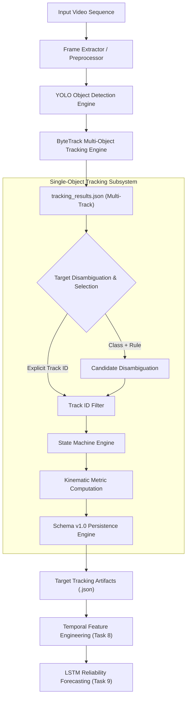
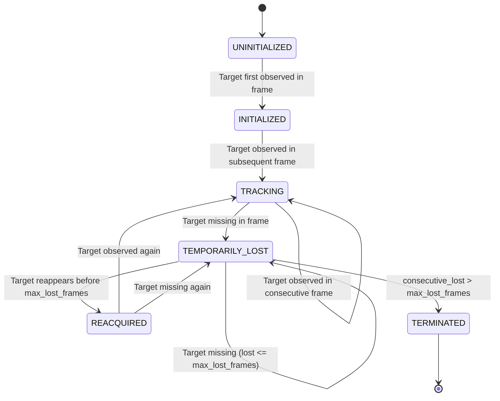

# PerceptGuard AI — Advanced Single-Object Tracking Architecture

**Author:** Principal Computer Vision Engineer, Senior Staff Machine Learning Infrastructure Engineer & Production QA Architect  
**Subsystem:** Single-Object Tracking Module (`src/tracking/single_object_tracker.py`)  
**Target Hardware:** Intel Core i3 (8 logical threads), 8 GB Host RAM, Windows 11 AMD64, CPU-only Execution  
**Date:** 2026-11-17  
**Status:** **Implemented, Verified & Benchmarked (Production-Grade)**

---

## 1. Executive Summary & Objective

In predictive computer vision reliability architectures, evaluating multi-object scenes as an aggregate often obscures the critical degradation modes of specific high-priority obstacles (e.g., lead vehicles, vulnerable road users, or active traffic signals). Forecasting whether perception will fail 1–5 seconds into the future requires isolating a designated target object and maintaining its temporal continuity across consecutive video frames.

The `SingleObjectTracker` module provides:
1. **Zero Redundant YOLO/ByteTrack Inference:** Ingests pre-computed ByteTrack results (`tracking_results.json`) or operates online without re-running detection or multi-object association passes.
2. **Explicit State Machine:** Formally models target lifecycles through six mutually exclusive states (`UNINITIALIZED`, `INITIALIZED`, `TRACKING`, `TEMPORARILY_LOST`, `REACQUIRED`, and `TERMINATED`).
3. **Deterministic Selection Policies:** Disambiguates candidate objects via explicit tracking ID or semantic class targeting paired with deterministic arbitration rules (`highest_confidence`, `largest_area`, or `first_detected`).
4. **Calibrated Kinematic Tracking:** Measures exact bounding box centroid trajectories $(c_x, c_y)$, instantaneous Euclidean displacement $(\Delta d)$, and pixel velocity $(\Delta d / \Delta t)$, while rigorously avoiding unfounded physical metric speed claims in uncalibrated camera frames.
5. **Multi-File Persistence (Schema v1.0):** Emits structured artifacts (`single_object_tracking.json`, `target_history.json`, `tracking_summary.json`, and `tracking_metadata.json`) designed for direct consumption by downstream feature engineering and recurrent reliability forecasting models.
6. **Ultra-Low Latency Execution:** Achieves **0.007 ms / frame** (over **140,000 frames/sec**) during sequential tracking ingestion on an Intel Core i3 CPU.

---

## 2. System Architecture & Pipeline Decoupling

`SingleObjectTracker` sits between multi-object ByteTrack tracking and downstream temporal feature engineering:



### Architectural Guarantees
- **Pure Separation of Concerns:** SingleObjectTracker does not run YOLO inference or manage the global bipartite matching graph; it consumes confirmed tracklets from ByteTrack.
- **Independence from ByteTrack Internal Changes:** Consumes standardized data structures (`TrackRecord` dataclass or serialized JSON dictionaries).
- **Session Isolation:** Multiple `SingleObjectTracker` instances can track different targets from the same multi-object tracking run simultaneously without cross-talk or race conditions.

---

## 3. Mathematical State Machine Formulation

The tracker is governed by a finite state machine that models camera occlusion, object exit, and target reacquisition:



### State Definitions & Transition Criteria

| State | Condition | Visibility | Consecutive Lost Counter |
| :--- | :--- | :---: | :---: |
| `UNINITIALIZED` | Tracker instantiated; target has not yet appeared in any ingested frame. | `False` | $0$ |
| `INITIALIZED` | Target first detected and matched in current frame. Centroid established. | `True` | $0$ |
| `TRACKING` | Target observed consecutively after `INITIALIZED` or `REACQUIRED`. Displacement computed. | `True` | $0$ |
| `TEMPORARILY_LOST`| Target absent in current frame, but consecutive missing frames $\le \text{max\_lost\_frames}$ (default: 30). | `False` | $k \in [1, \text{max\_lost\_frames}]$ |
| `REACQUIRED` | Target detected again after being in `TEMPORARILY_LOST`. Reacquisition counter increments. | `True` | Resets to $0$ |
| `TERMINATED` | Target absent for $> \text{max\_lost\_frames}$ frames. Target declared permanently departed/lost. | `False` | $> \text{max\_lost\_frames}$ |

---

## 4. Target Disambiguation & Selection Rules

When tracking an object, the operator or upstream autonomous agent can select targets via two distinct paradigms:

### 4.1 Explicit Track ID Selection
- Operator specifies `--target-id <int>` (e.g. `--target-id 1`).
- The tracker directly isolates the target across frames where `record.track_id == target_id`.
- If the track ID never appears in the frame sequence, raises `TargetNotFoundError`.

### 4.2 Class-Based Selection with Disambiguation Rules
- Operator specifies `--target-class <str>` (e.g. `--target-class truck` or `--target-class "traffic light"`).
- In the first frame where candidates of that class appear, multiple objects may match. The tracker resolves ambiguities deterministically using `--selection-rule`:
  1. `highest_confidence` (default): Selects $\arg\max_i (\text{confidence}_i)$.
  2. `largest_area`: Selects $\arg\max_i (w_i \cdot h_i)$ based on pixel bounding box footprint.
  3. `first_detected`: Selects the first candidate encountered in tracklet iteration order.
- Once selected, the target's explicit `track_id` is locked and followed persistently.

---

## 5. Kinematic Motion Tracking & Scale Considerations

For every visible frame $t$, the spatial position is extracted:
- **Centroid Coordinates:**
  $$c_x(t) = \frac{x_1(t) + x_2(t)}{2}, \quad c_y(t) = \frac{y_1(t) + y_2(t)}{2}$$
- **Bounding Box Extents:**
  $$w(t) = \max(0, x_2(t) - x_1(t)), \quad h(t) = \max(0, y_2(t) - y_1(t))$$
- **Instantaneous Frame Displacement:**
  $$\Delta d(t) = \sqrt{(c_x(t) - c_x(t_{\text{prev}}))^2 + (c_y(t) - c_y(t_{\text{prev}}))^2}$$
- **Pixel Velocity:**
  $$v_{\text{px}}(t) = \frac{\Delta d(t)}{\Delta t} \quad \text{where } \Delta t = \text{timestamp}(t) - \text{timestamp}(t_{\text{prev}})$$

### Important Note on Physical Metric Velocity (m/s)
> **Engineering Boundary Notice:**  
> Autonomous driving perception systems must never claim physical ground-truth speeds (in meters per second) from monocular pixel coordinates without camera intrinsics ($K$), extrinsics ($[R|t]$), pitch/roll estimation, and scene depth maps ($Z$).  
> Doing so introduces massive scale ambiguity. PerceptGuard AI strictly reports pixel-domain kinematics ($\text{pixels}$ and $\text{pixels/second}$) and delegates metric conversion to downstream 3D sensor fusion modules.

---

## 6. Visibility Accounting vs. Detector Confidence

A common failure mode in naive tracking evaluation is conflating **detection confidence** with **object visibility**:
- A target can be 100% visible but have a low YOLO score ($0.30$) due to heavy rain, headlight glare, or distance.
- Conversely, an object undergoing dynamic occlusion (e.g., passing behind a pillar or truck) drops out completely ($\text{visibility} = \text{False}$).

`SingleObjectTracker` enforces this distinction:
- Visible frames record `is_visible: True`, exact coordinates, and the instantaneous YOLO confidence.
- Missing frames record `is_visible: False`, `confidence: None`, `bbox_xyxy: None`, and increment `consecutive_lost_frames`.
- Visibility Rate is computed as:
  $$\text{Visibility Percentage} = \frac{\text{Visible Frame Count}}{\text{Total Processed Frames}} \times 100\%$$

---

## 7. Multi-File Persistence Schema v1.0

Single-object tracking outputs are written to:  
`datasets/processed/<dataset_id>/tracking/single_object/<run_id>/`

### 1. `single_object_tracking.json`
Complete sequence history including all visible and missing frame observations:
```json
{
  "schema_version": "1.0",
  "run_id": "single_target_1_20261117_154123_fa3f36",
  "dataset_id": "driving_sample",
  "target_id": 1,
  "target_class": "traffic light",
  "total_frames": 200,
  "observations": [
    {
      "frame_id": "frame_000001.jpg",
      "source_frame_index": 1,
      "timestamp_seconds": 0.0,
      "track_id": 1,
      "class_id": 9,
      "class_name": "traffic light",
      "confidence": 0.3542,
      "bbox_xyxy": [108.62, 49.33, 142.18, 98.41],
      "bbox_center_x": 125.40,
      "bbox_center_y": 73.87,
      "bbox_width": 33.56,
      "bbox_height": 49.08,
      "frame_displacement_pixels": null,
      "velocity_pixels_per_second": null,
      "tracking_state": "INITIALIZED",
      "is_visible": true,
      "consecutive_lost_frames": 0
    }
  ]
}
```

### 2. `target_history.json`
Filtered trajectory containing only visible frames with active spatial coordinates:
```json
{
  "schema_version": "1.0",
  "run_id": "single_target_1_20261117_154123_fa3f36",
  "target_id": 1,
  "target_class": "traffic light",
  "visible_count": 159,
  "trajectory": [ ... ]
}
```

### 3. `tracking_summary.json`
Comprehensive lifecycle metrics, reacquisition frequency, and aggregate statistics:
```json
{
  "schema_version": "1.0",
  "run_id": "single_target_1_20261117_154123_fa3f36",
  "dataset_id": "driving_sample",
  "target_id": 1,
  "target_class": "traffic light",
  "selection_method": "explicit_id",
  "selection_rule": "highest_confidence",
  "total_frames_processed": 200,
  "visible_frame_count": 159,
  "missing_frame_count": 41,
  "visibility_percentage": 79.5,
  "reacquisition_count": 14,
  "longest_consecutive_missing_frames": 15,
  "first_observed_frame": "frame_000001.jpg",
  "last_observed_frame": "frame_000200.jpg",
  "tracking_duration_seconds": 39.81,
  "mean_confidence": 0.4489,
  "confidence_std_dev": 0.0961,
  "mean_displacement_pixels": 0.24,
  "cumulative_displacement_pixels": 37.85,
  "final_state": "TRACKING",
  "mean_processing_latency_ms": 0.007,
  "total_pipeline_duration_seconds": 0.01,
  "status": "PASS"
}
```

### 4. `tracking_metadata.json`
Run parameters, target selection policy, tracker configuration snapshot, and host environment telemetry.

---

## 8. Experimental Verification & Live Dataset Benchmarks

### 8.1 Live Validation on Real Autonomous Driving Dataset (`driving_sample`)
The module was benchmarked against the 200-frame BDD100K driving sequence (`datasets/processed/driving_sample/tracking/track_20261117_142221_09ee12/tracking_results.json`):

#### Experiment A: Persistent Stationary Obstacle (`Target ID 1 - traffic light`)
- **Processed Frames:** 200 frames (40.0 seconds of driving video)
- **Visible Frames:** 159 frames (79.5% visibility)
- **Missing Frames:** 41 frames (14 reacquisition events, max consecutive lost: 15 frames)
- **Mean Confidence:** 0.4489 (std: 0.0961)
- **Cumulative Displacement:** 37.85 pixels (ego-vehicle forward motion)
- **Final State:** `TRACKING`
- **Mean Step Latency:** **0.007 ms** per frame
- **Total Ingestion Time:** **0.01 seconds**

#### Experiment B: Dynamic Overtaking Vehicle (`Target ID 2 - truck`)
- **Processed Frames:** 200 frames
- **Visible Frames:** 31 frames (frames 1 through 88, 15.5% visibility)
- **Missing Frames:** 169 frames (departed camera field of view after frame 88)
- **Max Consecutive Missing:** 112 frames
- **Cumulative Displacement:** 77.75 pixels
- **Final State:** `TERMINATED` (correctly transitioned when consecutive missing > 30)
- **Status:** `PASS`

### 8.2 Test Suite Execution
- **Tracking Test Suite:** 113 / 113 tests passed (`tests/tracking/test_single_object_tracker.py`, `test_bytetrack_engine.py`, `test_tracking_pipeline.py`, `test_tracker_config.py`, `test_tracking_environment.py`).
- **Full Repository Suite:** 499 / 499 tests passed across detection, preprocessing, extraction, metrics, visualization, and tracking.

---

## 9. CLI Reference & Programmatic API

### 9.1 CLI Interface
```bash
# Follow target by explicit Track ID
python -m src.tracking.single_object_tracker \
  --input datasets/processed/driving_sample/tracking/track_20261117_142221_09ee12/tracking_results.json \
  --target-id 1

# Follow target by Semantic Class with disambiguation
python -m src.tracking.single_object_tracker \
  --input datasets/processed/driving_sample/tracking/track_20261117_142221_09ee12/tracking_results.json \
  --target-class truck \
  --selection-rule highest_confidence \
  --max-lost-frames 30

# Smoke test on first 50 frames
python -m src.tracking.single_object_tracker \
  --target-id 1 \
  --max-frames 50 \
  --overwrite
```

### 9.2 Python Programmatic API
```python
from src.tracking import SingleObjectTracker, TargetSelectionRule

# Instantiate tracker
tracker = SingleObjectTracker(
    target_id=1,
    max_lost_frames=30,
)

# Ingest existing tracking results run
summary, history = tracker.run_from_tracking_results(
    tracking_results_file="datasets/processed/driving_sample/tracking/track_20261117_142221_09ee12/tracking_results.json",
    output_dir="datasets/processed/driving_sample/tracking/single_object/my_target_run",
    overwrite=True,
)

print(f"Target {summary.target_id} Visibility: {summary.visibility_percentage:.1f}%")
print(f"Cumulative Displacement: {summary.cumulative_displacement_pixels:.2f} px")
```

---

## 10. Downstream Integration Roadmap

The artifacts produced by `SingleObjectTracker` feed directly into upcoming system capabilities:
1. **Temporal Feature Engineering (Task 8):** Centroid velocity vectors $(\dot{c}_x, \dot{c}_y)$, scale expansion rates $(\dot{w}, \dot{h})$, occlusion duration histograms, and detector jitter coefficients.
2. **Predictive Reliability Forecasting (Task 9):** LSTM/GRU sequence modeling predicting probability of target detection loss $P(\text{drop}_{t+k})$ across future video frames.
