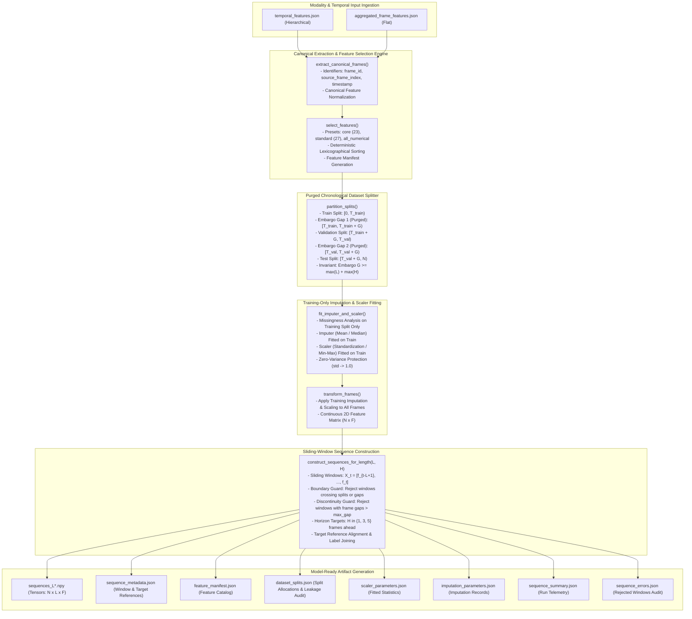

# Temporal Sequence Construction Specification
## Day 5 – Task 6 Architecture, Schema & Verification Contract

---

### 1. Executive Summary & Purpose

The **Temporal Sequence Construction Engine** (`src/features/temporal_sequence_builder.py`) transforms multi-modal chronological perception features and rolling temporal matrices (produced by Day 5 Task 5) into model-ready sliding-window sequence tensors for future LSTM/GRU-based predictive reliability forecasting models.

The system guarantees:
- **Zero Future-Frame Leakage:** Input windows $X_t = [f_{t-L+1}, \dots, f_t]$ strictly evaluate past and current observations. Future observations ($t + h$) are strictly quarantined as target references.
- **Purged Chronological Splitting:** Enforces temporal embargo gaps ($\text{gap} \ge \max(L) + \max(H)$) between Train, Validation, and Test splits. Overlapping windows from the same continuous video sequence cannot cross split boundaries.
- **Training-Derived Imputation and Scaling:** Scalers (Standardization, Min-Max) and Imputers (Mean, Median) are strictly fitted on the **TRAINING** split only. Validation and Test splits are transformed using training parameters without distribution leakage.
- **Explicit Physical Null Handling:** Non-detection and track-initialization frames preserve physical null semantics.
- **Model-Ready Serialization:** Emits compact NumPy `.npy` tensors (`sequences_L*.npy`) of shape $(N, L, F)$ alongside JSON metadata, feature manifests, and split manifests conforming to Schema v1.0.

---

### 2. Architecture & Pipeline Flow



---

### 3. Feature Selection & Deterministic Order

The standard feature set comprises 27 numerical features across detection, motion, visual quality, and temporal trend dynamics:

| Index | Feature Identifier | Domain Modality | Data Type | Physical Meaning |
|:-----:|:-------------------|:----------------|:---------:|:-----------------|
| 1 | `detection_count` | Detection | `int` | Number of detected objects |
| 2 | `unique_class_count` | Detection | `int` | Distinct detected object classes |
| 3 | `mean_confidence` | Detection | `float` | Average detector confidence |
| 4 | `confidence_std` | Detection | `float` | Standard deviation of confidences |
| 5 | `mean_bbox_area` | Detection | `float` | Mean bounding box area (pixels²) |
| 6 | `mean_bbox_width` | Detection | `float` | Mean bounding box width (pixels) |
| 7 | `mean_bbox_height` | Detection | `float` | Mean bounding box height (pixels) |
| 8 | `observed_track_count` | Motion | `int` | Total active object tracks |
| 9 | `moving_track_count` | Motion | `int` | Active tracks with speed > threshold |
| 10 | `stationary_track_count` | Motion | `int` | Active tracks with speed ≤ threshold |
| 11 | `mean_displacement` | Motion | `float` | Mean Euclidean displacement (pixels) |
| 12 | `maximum_displacement` | Motion | `float` | Maximum track displacement |
| 13 | `mean_speed` | Motion | `float` | Mean track speed (pixels/sec) |
| 14 | `mean_velocity_x` | Motion | `float` | Mean horizontal velocity |
| 15 | `mean_velocity_y` | Motion | `float` | Mean vertical velocity |
| 16 | `motion_feature_coverage` | Motion | `float` | Ratio of tracks with valid motion |
| 17 | `blur_score` | Visual Quality | `float` | Laplacian variance (sharpness) |
| 18 | `mean_brightness` | Visual Quality | `float` | Mean pixel intensity [0, 255] |
| 19 | `brightness_std` | Visual Quality | `float` | Intensity standard deviation |
| 20 | `contrast_std` | Visual Quality | `float` | RMS contrast |
| 21 | `contrast_range` | Visual Quality | `float` | Peak-to-peak intensity span |
| 22 | `contrast_percentile_range` | Visual Quality | `float` | 95th - 5th percentile intensity |
| 23 | `numeric_feature_coverage` | Temporal | `float` | Modality data completeness |
| 24 | `w3_confidence_trend_slope` | Temporal | `float` | OLS linear slope of confidence (W=3) |
| 25 | `w3_blur_trend_slope` | Temporal | `float` | OLS linear slope of blur score (W=3) |
| 26 | `w5_confidence_trend_slope` | Temporal | `float` | OLS linear slope of confidence (W=5) |
| 27 | `w5_blur_trend_slope` | Temporal | `float` | OLS linear slope of blur score (W=5) |

---

### 4. Sliding-Window Sequence Construction

For sequence length $L \in \{5, 10, 15, 20\}$ and frame sequence indexed $t \in [L-1, N-1]$:
$$X_t = \begin{bmatrix}
f_{t - L + 1, 1} & \dots & f_{t - L + 1, F} \\
\vdots & \ddots & \vdots \\
f_{t, 1} & \dots & f_{t, F}
\end{bmatrix} \in \mathbb{R}^{L \times F}$$

**Window Acceptance Invariants:**
1. **Split Uniformity:** $\forall j \in [t - L + 1, t], \text{split}(j) = \text{split}(t) \land \text{split}(t) \notin \{\text{"purged\_gap\_1"}, \text{"purged\_gap\_2"}\}$.
2. **Temporal Continuity:** Adjacent frames must satisfy $S_j - S_{j-1} \le \text{max\_sequence\_gap\_frames} \times \text{median\_stride}$.
3. **Finite Values:** All elements in $X_t$ must be finite ($\text{NaN}, \pm\infty$ barred).

---

### 5. Forecasting Horizons & Target Frame Invariants

For each valid input window ending at frame $t$, targets are evaluated for horizons $h \in \{1, 3, 5\}$:
- Target index: $t_{\text{target}} = t + h$.
- If $t_{\text{target}} < N$:
  - `target_frame_id`: Frame ID at $t + h$
  - `target_source_frame_index`: Source frame index at $t + h$
  - `target_timestamp_seconds`: Timestamp at $t + h$
  - `target_frame_gap`: Source frame step ($S_{t+h} - S_t$)
  - `target_status`: `"valid"`
- If $t_{\text{target}} \ge N$:
  - `target_status`: `"out_of_bounds"`

**Target Label Policy:**
- In accordance with project architecture, YOLO confidence is **never** fabricated into ground-truth reliability labels.
- Target reliability labels remain marked as `target_label_available: false` and `target_label: null` until ground truth annotations are ingested in Day 6.

---

### 6. Purged Chronological Dataset Splitting & Zero-Leakage Guarantee

To prevent overlapping windows from leaking information across dataset splits:
- Dataset is divided into 3 partitions separated by 2 temporal embargo gaps:
  $$\text{Train}: [0, 105), \quad \text{Gap 1}: [105, 130), \quad \text{Val}: [130, 152), \quad \text{Gap 2}: [152, 177), \quad \text{Test}: [177, 200)$$
- **Embargo Gap:** $G = 25 \text{ frames} = \max(L) + \max(H) = 20 + 5$.
- **Mathematical Invariant:**
  $$\mathcal{F}_{\text{Train}} \cap \mathcal{F}_{\text{Val}} = \emptyset, \quad \mathcal{F}_{\text{Train}} \cap \mathcal{F}_{\text{Test}} = \emptyset, \quad \mathcal{F}_{\text{Val}} \cap \mathcal{F}_{\text{Test}} = \emptyset$$
  Verified across all generated sequences with 100% mutual exclusivity.

---

### 7. Real Data Validation: BDD100K Driving Sample

Executed on the official 200-frame BDD100K sequence:
- **Input:** `datasets/processed/driving_sample/features/temporal/run_official/temporal_features.json`
- **Output:** `datasets/processed/driving_sample/features/sequences/run_official/`
- **Total Frames:** 200
- **Feature Count:** 27
- **Scaling:** Standardization ($z = \frac{x - \mu}{\sigma}$, fitted on training split only)
- **Imputation:** Mean imputation (fitted on training split only)

**Generated Sequence Counts & Tensor Shapes:**
- **$L=5$:** 138 sequences, shape `(138, 5, 27)` (Train: 101, Val: 18, Test: 19)
- **$L=10$:** 123 sequences, shape `(123, 10, 27)` (Train: 96, Val: 13, Test: 14)
- **$L=15$:** 108 sequences, shape `(108, 15, 27)` (Train: 91, Val: 8, Test: 9)
- **$L=20$:** 93 sequences, shape `(93, 20, 27)` (Train: 86, Val: 3, Test: 4)

---

### 8. CLI Usage Guide

```powershell
# Generate model sequences with standardization and training-derived imputation
python -m src.features.temporal_sequence_builder `
    --input datasets/processed/driving_sample/features/temporal/run_official/temporal_features.json `
    --output datasets/processed/driving_sample/features/sequences/run_official `
    --sequence-lengths 5,10,15,20 `
    --horizons 1,3,5 `
    --scaling standardization `
    --missing-policy impute_mean `
    --overwrite `
    --verbose

# Dry-run validation of input artifact and feature feasibility
python -m src.features.temporal_sequence_builder `
    --input datasets/processed/driving_sample/features/temporal/run_official/temporal_features.json `
    --validate-only
```
